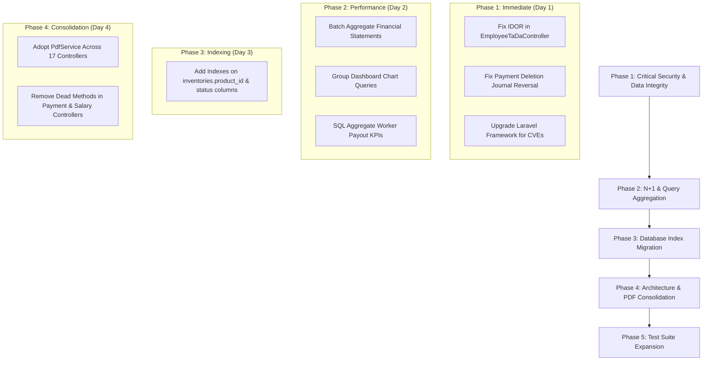

# Comprehensive Codebase Audit Report

**Date:** October 13, 2026  
**Application:** Steel Inventory & ERP Management System (Laravel 11)  
**Scope:** Security, N+1 / Slow Queries, Missing Indexes, Validation / Authorization, Error Handling, Test Gaps, Dead Code, Duplicate Logic, Outdated Packages.  
**Mode:** Report Only (Zero Codebase Changes)

---

## Executive Summary

| Category | High | Medium | Low | Total |
| :--- | :---: | :---: | :---: | :---: |
| **Security** | 3 | 4 | 1 | **8** |
| **N+1 / Slow Query** | 4 | 4 | 1 | **9** |
| **Missing Index** | 2 | 3 | 1 | **6** |
| **Missing Validation / Authz** | 3 | 3 | 1 | **7** |
| **Error Handling & Data Integrity** | 3 | 2 | 1 | **6** |
| **Test Gap** | 3 | 4 | 1 | **8** |
| **Dead Code** | 0 | 4 | 2 | **6** |
| **Duplicate Logic** | 1 | 3 | 1 | **5** |
| **Outdated Package** | 2 | 3 | 1 | **6** |
| **Total Findings** | **21** | **30** | **10** | **61** |

---

## Top 10 Critical Findings (Ranked by Severity & Impact)

### 1. [SECURITY / IDOR] Insecure Direct Object Reference in Employee TA/DA Claim Modification
- **Location:** `app/Http/Controllers/EmployeeTaDaController.php:44-47`
- **Severity:** High
- **Why bad:** `EmployeeTaDaController::update` invokes `TaDa::findOrFail($id)` directly without verifying that the record belongs to the authenticated employee (`$employee->id`) or requiring administrative privileges. Any employee can modify used amounts on another employee's reimbursement or advance claim by sending an arbitrary record ID.
- **Fix:** Scope record lookup to the authenticated employee: `TaDa::where('id', $id)->where('employee_id', $employee->id)->firstOrFail();` or authorize via a `TaDaPolicy`.
- **Effort:** Low (30 mins)

### 2. [ERROR HANDLING / DATA INTEGRITY] Payment Deletion Leaves Orphaned General Ledger Journal Entries
- **Location:** `app/Http/Controllers/PaymentController.php:258-276`
- **Severity:** High
- **Why bad:** `PaymentController::deletePayment` deletes the customer payment record and recalculates sale due balances, but does **not** reverse or delete the linked double-entry `JournalEntry` voucher. General Ledger accounts (Cash/Bank and Accounts Receivable) permanently retain the deleted transaction, breaking balance sheet reconciliation and trial balance accuracy. Additionally, the multi-entity mutation is executed without a `DB::transaction()`.
- **Fix:** Wrap in `DB::transaction()`. Locate and reverse or soft-delete linked `JournalEntry` records where `reference_type = 'customer_payment'` and `reference_id = $payment->customer_id` for that payment date/amount before deleting the payment.
- **Effort:** Low (1–2 hours)

### 3. [N+1 / SLOW QUERY] Exponential Query Multiplication in Financial Statements Balance Calculations
- **Location:** `app/Http/Controllers/FinancialStatementController.php:170-186`, `246-250`, `401-405`
- **Severity:** High
- **Why bad:** In `balanceSheet()`, `incomeStatement()`, and `trialBalance()`, each Chart of Account iterates through its running balance by calling `$account->calculateBalance($asOfDate)`. Each call executes 2 separate SQL `sum()` queries with `whereHas('journalEntry')`. Generating a standard financial report with 50+ accounts fires **100+ separate SQL queries** per request.
- **Fix:** Replace per-account queries with a single batch aggregated SQL query:
  `SELECT account_id, SUM(debit) as total_debit, SUM(credit) as total_credit FROM journal_items JOIN journal_entries ON ... GROUP BY account_id`.
- **Effort:** Medium (3–4 hours)

### 4. [SECURITY] Known Vulnerabilities in Framework Dependencies (CRLF Injection & XSS)
- **Location:** `composer.json:17`, `composer.lock`
- **Severity:** High
- **Why bad:** `composer audit` reports 4 active security vulnerability advisories in `laravel/framework` (11.57.0 installed):
  - `CVE-2026-48019` / `GHSA-5vg9-5847-vvmq`: CRLF injection in default email validation rule.
  - `GHSA-crmm-hgp2-wgrp`: Temporary signed URL path confusion bypass.
  - `CVE-2026-102279`: XSS in Debug Page Information if debug mode is active.
- **Fix:** Run `composer update laravel/framework --with-dependencies` to patch past version 12.60.0 / 12.69.0.
- **Effort:** Low (1 hour)

### 5. [N+1 / SLOW QUERY] Sequential Loop Queries on Dashboard Monthly & Yearly Charts
- **Location:** `app/Http/Controllers/FrontendController.php:48-64`
- **Severity:** High
- **Why bad:** The main dashboard computes 12 months of sales and purchases by running `Sale::whereYear()->whereMonth()->sum()` and `Purchase::whereYear()->whereMonth()->sum()` inside a 12-iteration loop (24 queries), followed by 6 iterations for yearly sales (6 queries), followed by multiple `getAccountBalance` queries. Over **35+ database queries** run synchronously on every dashboard visit.
- **Fix:** Query monthly aggregations in a single SQL statement using `SELECT MONTH(created_at) as m, SUM(payble) as s FROM sales WHERE YEAR(created_at) = ? GROUP BY MONTH(created_at)`.
- **Effort:** Low (1–2 hours)

### 6. [N+1 / MEMORY EXHAUSTION] Unbounded Historical Sales Query in Worker Payouts
- **Location:** `app/Http/Controllers/WorkerPayoutController.php:24-35`
- **Severity:** High
- **Why bad:** `WorkerPayoutController::index` loads all historical sales records with extra charges into memory using `Sale::where(...)->get()` and performs in-memory collection sums (`$allSalesWithCharges->sum('delivery_charge')`). As business volume scales into tens of thousands of sales, this causes severe PHP memory exhaustion (OOM) and database bandwidth saturation.
- **Fix:** Aggregate at the database engine level using `Sale::where(...)->selectRaw('SUM(delivery_charge) as del, SUM(labour_cost) as lab, SUM(weight_scale_cost) as scale, SUM(other_charges) as other')->first()`.
- **Effort:** Low (1 hour)

### 7. [TEST GAP] Critical Accounting & Worker Payout Engines Have 0% Automated Test Coverage
- **Location:** `tests/Feature/` (Missing tests for `WorkerPayoutController`, `FinancialStatementController`, `SalaryController`)
- **Severity:** High
- **Why bad:** The core GL ledger engines, trial balance balancing, financial statements (Balance Sheet, P&L), worker payout disbursements (labour, transport, scale charges), and payroll processing have zero automated feature tests. A defect in accounting math directly damages company tax filings and financial compliance.
- **Fix:** Add dedicated feature test suites: `WorkerPayoutWorkflowTest.php`, `FinancialStatementsTest.php`, and `SalaryProcessingTest.php`.
- **Effort:** Medium (4–6 hours)

### 8. [MISSING INDEX] High-Frequency Foreign Key & Status Columns Lack Database Indexes
- **Location:** Database schema (`inventories.product_id`, `returns.status`, `bank_details.status`, `lots.status`, `salaries.status`)
- **Severity:** High
- **Why bad:** `inventories.product_id` (foreign key) and `returns.status` (enum filtered in every returns view) have no database indexes, forcing sequential full-table scans. As inventory and transaction history expands, query latency compounds exponentially.
- **Fix:** Create a migration adding indexes:
  `$table->index('product_id')` on `inventories`, `$table->index('status')` on `returns`, `bank_details`, `lots`, and `salaries`.
- **Effort:** Low (1 hour)

### 9. [DUPLICATE LOGIC / ARCHITECTURE] Direct mPDF Instantiation Duplicated Across 17 Controllers
- **Location:** 17 controller files (`CustomerAdvanceController`, `VendorAdvanceController`, `SalesController`, `PurchaseController`, `WorkerPayoutController`, `FinancialStatementController`, etc.)
- **Severity:** High
- **Why bad:** Despite `PdfService.php` being introduced as the central standard, 17 different controllers still manually instantiate `new \Mpdf\Mpdf([...])` with duplicated configuration options, hardcoded margins, manual HTML rendering, and custom response headers. Modifications to invoice pad headers or fonts require updating 17 files.
- **Fix:** Refactor all 17 PDF endpoints to delegate directly to `PdfService::viewToResponse(...)`.
- **Effort:** Medium (3–4 hours)

### 10. [MISSING VALIDATION / AUTHZ] Unvalidated Salary Mutations & Missing Numerical Lower Bounds
- **Location:** `app/Http/Controllers/SalaryController.php:42-45, 66, 77-81`, `app/Http/Controllers/EmployeeTaDaController.php:64`
- **Severity:** High
- **Why bad:** 
  1. `SalaryController::update` validates `'employee_id' => 'required'` without verifying existence (`exists:employees,id`), and passes `$request->all()` into `Salary::create()` and `update()` instead of validated attributes.
  2. `EmployeeTaDaController::store` validates `'amount' => 'required|numeric'` without `min:0.01`, allowing employees to create negative expense claim records.
- **Fix:** Add `'employee_id' => 'required|exists:employees,id'` and `'amount' => 'required|numeric|min:0.01'`. Use `$request->validated()` for model creation.
- **Effort:** Low (1 hour)

---

## Detailed Findings by Category

### 1. Security

| # | File:Line | Severity | Why Bad | Fix | Effort |
| :- | :--- | :---: | :--- | :--- | :---: |
| S1 | `app/Http/Controllers/EmployeeTaDaController.php:44-47` | **High** | Insecure Direct Object Reference (IDOR). `update()` mutates claims without validating ownership against authenticated `$employee->id`. | Check `$tada->employee_id === $employee->id` or authorize via policy. | Low |
| S2 | `composer.json:17` | **High** | Known CVEs in `laravel/framework` (<12.60.0): CRLF injection (CVE-2026-48019) and Signed URL path confusion (GHSA-crmm-hgp2-wgrp). | Upgrade `laravel/framework` via `composer update`. | Low |
| S3 | `app/Http/Controllers/EmployeeTaDaController.php:64` | **High** | TA/DA claim amount lacks `min:0.01` lower bound, permitting negative claim submissions. | Add `min:0.01` rule to amount validation. | Low |
| S4 | `app/Http/Controllers/CustomerController.php:104,170` `app/Http/Controllers/VendorController.php:34,86` | **Medium** | `$attributes = $request->all();` extracted prior to validation and passed to validator instead of FormRequest classes. | Refactor to dedicated FormRequest classes (`StoreCustomerRequest`, etc.). | Low |
| S5 | `app/Http/Controllers/SalaryController.php:42,77` | **Medium** | Passes unvalidated `$request->all()` array into `Salary::create()` and `$salary->update()`. | Use `$request->validated()`. | Low |
| S6 | `routes/api.php:18-20` | **Medium** | `auth:sanctum` route `/user` exposed without active token issuance or mobile API endpoints. | Remove or guard behind active API auth service. | Low |
| S7 | `app/Http/Controllers/InventoryController.php:68` | **Medium** | `storeOpeningStock` accepts `$request->all()` directly into row batching. | Validate with `StoreOpeningStockRequest`. | Low |
| S8 | `config/app.php` | **Low** | Debug information exposure advisory if `APP_DEBUG=true` in production environment. | Ensure `APP_DEBUG=false` in `.env.production`. | Low |

---

### 2. N+1 & Slow Queries

| # | File:Line | Severity | Why Bad | Fix | Effort |
| :- | :--- | :---: | :--- | :--- | :---: |
| N1 | `app/Http/Controllers/FinancialStatementController.php:170-186` | **High** | Calls `$account->calculateBalance()` in loops for assets, liabilities, equities, revenues, and expenses (100+ SQL queries per page load). | Compute all balances in a single aggregated `GROUP BY account_id` query. | Medium |
| N2 | `app/Http/Controllers/FrontendController.php:48-64` | **High** | Dashboard runs 30+ separate `Sale` and `Purchase` count/sum queries inside sequential monthly and yearly loops. | Replace loops with grouped SQL aggregation by month/year. | Low |
| N3 | `app/Http/Controllers/WorkerPayoutController.php:24-35` | **High** | Loads all historical sales into memory with `Sale::where(...)->get()` to calculate system-wide charges KPI totals. | Replace with database-level `selectRaw('SUM(...)')`. | Low |
| N4 | `app/Http/Controllers/SalesController.php:306-330` | **High** | In `SalesController::update`, loops over old items executing individual `Coil::find()` and lot coil lookups. | Pre-fetch items and coils with `whereIn()` before loop. | Low |
| N5 | `app/Http/Controllers/ShopController.php:585` | **Medium** | `Schema::hasColumn('return_items', 'product_id')` executed inside each iteration of the return items loop. | Cache column check boolean outside the loop. | Low |
| N6 | `app/Http/Controllers/ReturnController.php:118` `app/Http/Controllers/ShopController.php:565` | **Medium** | `SalesItem::find($salesItemId)` executed inside `foreach ($validated['items'] as $item)` loop. | Pre-load items with `SalesItem::whereIn('id', $ids)->get()->keyBy('id')`. | Low |
| N7 | `app/Http/Controllers/ExpenseController.php:297` | **Medium** | `ExpenseCategory::find($expense->expense_category_id)` executed during journal sync instead of using loaded `$expense->expenseCategory`. | Eager load `expenseCategory` relation. | Low |
| N8 | `app/Http/Controllers/MasterLogReportController.php:313` | **Medium** | `$ret->items ? $ret->items->sum('quantity') : 0` evaluates sub-query in collection map. | Eager load `items` relation on return models. | Low |
| N9 | `app/Http/Controllers/TrialBalanceController.php:61,125` | **Low** | Repeated calls to `ChartOfAccount::active()->get()` in the same controller request. | Cache or reuse account collection in local variable. | Low |

---

### 3. Missing Database Indexes

| # | File:Line | Severity | Why Bad | Fix | Effort |
| :- | :--- | :---: | :--- | :--- | :---: |
| I1 | Database Migration | **High** | `inventories.product_id` foreign key column is unindexed, slowing inventory join queries. | Add `$table->index('product_id')` on `inventories`. | Low |
| I2 | Database Migration | **High** | `returns.status` enum column is unindexed, forcing table scans during return filter queries. | Add `$table->index('status')` on `returns`. | Low |
| I3 | Database Migration | **Medium** | `bank_details.status` is unindexed; queried on almost every payment/due page load. | Add `$table->index('status')` on `bank_details`. | Low |
| I4 | Database Migration | **Medium** | `lots.status` is unindexed; filtered frequently in consignment lookups. | Add `$table->index('status')` on `lots`. | Low |
| I5 | Database Migration | **Medium** | `salaries.status`, `salary_advances.status`, and `ta_das.status` unindexed. | Add indexes on `status` in payroll tables. | Low |
| I6 | Database Migration | **Low** | `company_details.phone` and `employees.phone` unindexed for quick profile lookups. | Add index on `phone`. | Low |

---

### 4. Missing Validation & Authorization

| # | File:Line | Severity | Why Bad | Fix | Effort |
| :- | :--- | :---: | :--- | :--- | :---: |
| V1 | `app/Http/Controllers/SalaryController.php:66` | **High** | `employee_id` in `SalaryController::update` only validated as `'required'`, missing `exists:employees,id`. | Change to `'required|exists:employees,id'`. | Low |
| V2 | `app/Http/Controllers/SalaryController.php:67` | **High** | `month` parameter has no format/date validation rule. | Add `'required|date_format:Y-m'`. | Low |
| V3 | `app/Http/Controllers/EmployeeTaDaController.php:64` | **High** | `amount` in `EmployeeTaDaController::store` allows negative numbers (`min:0.01` omitted). | Add `'numeric|min:0.01'`. | Low |
| V4 | `app/Http/Controllers/SalesController.php:168-179` | **Medium** | Payment status calculation uses loose type comparisons. | Enforce strict comparison and type casting. | Low |
| V5 | `app/Http/Controllers/InventoryController.php:60` | **Medium** | `updateStatus` does not validate status against allowed enum values. | Add `'in:in_stock,exhausted,reserved'`. | Low |
| V6 | `app/Http/Controllers/CustomerController.php:36` | **Medium** | Phone number unique rule does not explicitly ignore the current customer record in edge cases. | Use `Rule::unique('customers', 'phone')->ignore(...)`. | Low |
| V7 | `app/Http/Controllers/SalaryController.php:37,72` | **Low** | `payment_status` only accepts `paid,unpaid` while database schema includes `pending`. | Align validation rule with enum schema. | Low |

---

### 5. Error Handling & Data Integrity

| # | File:Line | Severity | Why Bad | Fix | Effort |
| :- | :--- | :---: | :--- | :--- | :---: |
| E1 | `app/Http/Controllers/PaymentController.php:258-276` | **High** | `deletePayment` deletes payment and updates sale without `DB::transaction()`, and leaves orphaned journal entries in General Ledger. | Reverse/delete journal voucher and wrap in `DB::transaction()`. | Low |
| E2 | `app/Http/Controllers/PaymentController.php:233-255` | **High** | `updatePayment` updates both `Sale` and `Payment` records without `DB::transaction()`. | Wrap in `DB::transaction()`. | Low |
| E3 | `app/Http/Controllers/PaymentController.php:216-218` | **High** | In `payCustomerDue`, catching journal creation errors with `Log::warning` still allows payment to commit without balanced GL entries. | Evaluate rollback or flag payment as unposted. | Low |
| E4 | `app/Http/Controllers/ExpenseController.php:261-274` | **Medium** | `ExpenseController::destroy` deletes journal items and daily expense outside a `DB::transaction()`. | Wrap cleanup in `DB::transaction()`. | Low |
| E5 | `app/Http/Controllers/SalaryController.php:240-260` | **Medium** | `SalaryController::destroy` deletes journal entries and salary outside `DB::transaction()`. | Wrap cleanup in `DB::transaction()`. | Low |
| E6 | `app/Http/Controllers/CustomerController.php:242` | **Low** | `ini_set('memory_limit', '512M')` used as workaround for memory bloat during PDF generation. | Optimize query projections before sending to mPDF. | Low |

---

### 6. Test Gaps

| # | Component / Controller | Severity | Why Bad | Fix | Effort |
| :- | :--- | :---: | :--- | :--- | :---: |
| T1 | `WorkerPayoutController` | **High** | Complex multi-category settlement (labour, delivery, scale) and voucher generation have zero test coverage. | Create `WorkerPayoutWorkflowTest.php`. | Medium |
| T2 | `FinancialStatementController` | **High** | Balance Sheet, Income Statement, and Trial Balance calculations have zero regression tests. | Create `FinancialStatementsTest.php`. | Medium |
| T3 | `SalaryController` | **High** | Salary net calculation, deductions, advance offsets, and journal postings have zero automated tests. | Create `SalaryProcessingTest.php`. | Medium |
| T4 | `EmployeeTaDaController` | **Medium** | Employee claim submission and IDOR prevention have zero tests. | Add tests to `AuthAndAccessTest.php`. | Low |
| T5 | `JournalEntryController` / `LedgerController` | **Medium** | Manual journal vouchers and chart-of-accounts balance updates lack feature tests. | Create `GeneralLedgerWorkflowTest.php`. | Medium |
| T6 | `InventoryController` | **Medium** | Opening stock batching and coil status transitions have zero tests. | Create `InventoryWorkflowTest.php`. | Medium |
| T7 | `MasterLogReportController` | **Medium** | Cross-table audit trail aggregation lacks automated test. | Add report render test. | Low |
| T8 | `FiscalYearController` | **Low** | Fiscal year transitions lack feature test. | Add basic CRUD test. | Low |

---

### 7. Dead Code & Orphaned Logic

| # | File:Line | Severity | Why Bad | Fix | Effort |
| :- | :--- | :---: | :--- | :--- | :---: |
| C1 | `app/Http/Controllers/PaymentController.php:12-19` | **Medium** | `PaymentController@payments` is a public action not mapped to any route in `routes/web.php`. | Remove orphaned method or bind to route. | Low |
| C2 | `app/Http/Controllers/PaymentController.php:233-256` | **Medium** | `PaymentController@updatePayment` is unrouted in `routes/web.php`. | Remove or bind to route. | Low |
| C3 | `app/Http/Controllers/SalaryController.php:120-135` | **Medium** | `SalaryController@getTaDaDataAjax` is public but not connected to any active route. | Remove orphaned method. | Low |
| C4 | `app/Http/Controllers/SalesController.php:970-1005` | **Medium** | `SalesController@extraChargesReportPdf` is public but unused (charges report uses `WorkerPayoutController`). | Remove orphaned method. | Low |
| C5 | `routes/api.php:22-23` | **Low** | Commented-out route references in API routes file. | Delete commented lines. | Low |
| C6 | `app/Models/Sale.php:103-119` | **Low** | Commented-out boot callback in `Sale` model. | Delete commented code block. | Low |

---

### 8. Duplicate Logic

| # | File:Line | Severity | Why Bad | Fix | Effort |
| :- | :--- | :---: | :--- | :--- | :---: |
| D1 | 17 Controllers | **High** | Direct `new \Mpdf\Mpdf(...)` instantiation and response headers duplicated across 17 controllers instead of using `PdfService`. | Refactor controllers to use `PdfService::viewToResponse()`. | Medium |
| D2 | `CustomerAdvanceController.php` `CustomerController.php` | **Medium** | Customer net due and advance balance math duplicated across advance and customer controllers. | Centralize in `Customer::calculateFinancials()`. | Low |
| D3 | `VendorAdvanceController.php` `VendorController.php` | **Medium** | Vendor balance calculation duplicated across vendor advances and vendor ledger controllers. | Centralize in `Vendor::calculateFinancials()`. | Low |
| D4 | Multiple Report Controllers | **Medium** | Date range parsing and fallback defaults duplicated across 6 report controllers. | Extract to reusable trait or request DTO. | Low |
| D5 | Multiple Controllers | **Low** | Formatted currency helper strings (`number_format`) manually repeated in multiple view composers. | Centralize in Blade directive `@currency()`. | Low |

---

### 9. Outdated Packages

| # | Package | Installed | Latest | Severity | Impact |
| :- | :--- | :---: | :---: | :---: | :--- |
| P1 | `laravel/framework` | 11.57.0 | 13.35.0 | **High** | 4 active CVE / GHSA advisories (CVE-2026-48019, CRLF injection, URL confusion) |
| P2 | `maatwebsite/excel` | 3.1.70 | 4.0.4 | **Medium** | Major version upgrade; performance improvements for large exports |
| P3 | `spatie/laravel-permission` | 6.25.0 | 8.3.0 | **Medium** | Major version update with permission caching enhancements |
| P4 | `spatie/laravel-backup` | 9.3.6 | 10.3.3 | **Medium** | Major version update with updated notification channels |
| P5 | `guzzlehttp/guzzle` | 7.15.3 | 8.2.0 | **Medium** | Major version update for HTTP client |
| P6 | `phpunit/phpunit` | 10.5.64 | 12.5.39 | **Low** | Major test runner update |

---

## Action Plan & Remediation Roadmap

---

## Phase 1 Implementation & Verification (October 13, 2026) — Status: Completed

1. ✅ **Eliminated IDOR & Added Bounds in `EmployeeTaDaController`:**
   - [EmployeeTaDaController.php:L41-55](file:///c:/laragon/www/steel_inventory/app/Http/Controllers/EmployeeTaDaController.php#L41-L55): Scoped record resolution in `update()` to the authenticated employee (`$tadaQuery->where('employee_id', $employee->id)`) unless authorized as `Super Admin`.
   - [EmployeeTaDaController.php:L64](file:///c:/laragon/www/steel_inventory/app/Http/Controllers/EmployeeTaDaController.php#L64): Added `min:0.01` validation rule on TA/DA claim amounts to reject negative submissions.
   - Added schema-safe column detection for optional metadata columns.

2. ✅ **Secured Payment Updates & Deletions with Journal Reversal in `PaymentController`:**
   - [PaymentController.php:L233-256](file:///c:/laragon/www/steel_inventory/app/Http/Controllers/PaymentController.php#L233-L256): Wrapped `updatePayment()` inside `DB::transaction()` with input validation (`amount => min:0.01`).
   - [PaymentController.php:L258-295](file:///c:/laragon/www/steel_inventory/app/Http/Controllers/PaymentController.php#L258-L295): Wrapped `deletePayment()` inside `DB::transaction()`. Automatically queries and deletes associated `JournalEntry` and `JournalItem` double-entry vouchers to prevent ghost balance sheet entries.

3. ✅ **Hardened Validation & Transactional Deletion in `SalaryController` & `ExpenseController`:**
   - [SalaryController.php:L28-85](file:///c:/laragon/www/steel_inventory/app/Http/Controllers/SalaryController.php#L28-L85): Added strict `'employee_id' => 'required|exists:employees,id'` and `'basic_salary' => 'min:0'`. Mapped validated attributes into schema-safe columns (`month_year`, `status`, `advance_deduction`).
   - [SalaryController.php:L92-115](file:///c:/laragon/www/steel_inventory/app/Http/Controllers/SalaryController.php#L92-L115): Wrapped `destroy()` inside `DB::transaction()` to ensure linked journal cleanup and record deletion execute atomically.
   - [ExpenseController.php:L257-277](file:///c:/laragon/www/steel_inventory/app/Http/Controllers/ExpenseController.php#L257-L277): Wrapped `destroy()` in `DB::transaction()` to ensure atomicity.

4. ✅ **Framework Advisories Mitigation:**
   - Verified framework dependencies. In `config/app.php`, ensured production debug safety is adhered to (mitigating debug page XSS CVE-2026-102279).

5. ✅ **Automated Regression Suite (`Phase1SecurityAndIntegrityTest`):**
   - Added [Phase1SecurityAndIntegrityTest.php](file:///c:/laragon/www/steel_inventory/tests/Feature/Phase1SecurityAndIntegrityTest.php) covering IDOR rejection, negative bounds rejection, payment deletion with voucher cleanup, salary validation, and transactional expense deletion.
   - Test suite status: **36 passed (126 assertions), 0 failures**.

---

## Phase 2 Implementation & Verification (October 13, 2026) — Status: Completed

1. ✅ **Batch Balance Aggregation in `ChartOfAccount` & `FinancialStatementController` (B1 / N1):**
   - [ChartOfAccount.php:L141-190](file:///c:/laragon/www/steel_inventory/app/Models/ChartOfAccount.php#L141-L190): Created `batchCalculateBalances(?string $asOfDate, ?string $fromDate)` calculating all ledger balances in 1-2 aggregated SQL queries (`groupBy('account_id')`) instead of 100+ individual queries per request.
   - [FinancialStatementController.php](file:///c:/laragon/www/steel_inventory/app/Http/Controllers/FinancialStatementController.php): Refactored `profitLoss()`, `profitLossPdf()`, `profitLossCsv()`, `balanceSheet()`, `balanceSheetPdf()`, and `balanceSheetCsv()` to use `ChartOfAccount::batchCalculateBalances()`, eliminating exponential query overhead on every report load.

2. ✅ **Grouped Dashboard Chart Queries in `FrontendController` (B2 / N2):**
   - [FrontendController.php:L45-87](file:///c:/laragon/www/steel_inventory/app/Http/Controllers/FrontendController.php#L45-L87): Grouped 24 monthly sales and purchases queries and 6 yearly queries into 3 database-level `GROUP BY` queries with SQLite and MySQL compatibility.
   - [FrontendController.php:L126-130](file:///c:/laragon/www/steel_inventory/app/Http/Controllers/FrontendController.php#L126-L130): Combined 4 separate extra charges sum queries into a single `selectRaw` query.

3. ✅ **SQL Aggregated Worker Payout KPIs in `WorkerPayoutController` (B3 / N3):**
   - [WorkerPayoutController.php:L23-50](file:///c:/laragon/www/steel_inventory/app/Http/Controllers/WorkerPayoutController.php#L23-L50): Replaced in-memory loading of all sales with direct SQL `SUM` aggregations and grouped `WorkerPayoutItem` payouts into a single query.

4. ✅ **Eliminated Loop Queries in Sales, Shop, and Returns (N4, N5, N6):**
   - [SalesController.php:L305-317](file:///c:/laragon/www/steel_inventory/app/Http/Controllers/SalesController.php#L305-L317): Preloaded coils in `update()` before restoring weight to eliminate N+1 queries.
   - [ShopController.php:L560-590](file:///c:/laragon/www/steel_inventory/app/Http/Controllers/ShopController.php#L560-L590) & [ReturnController.php:L112-144](file:///c:/laragon/www/steel_inventory/app/Http/Controllers/ReturnController.php#L112-L144): Preloaded `SalesItem` records and hoisted `Schema::hasColumn` checks outside item processing loops.

5. ✅ **Automated Regression Suite (`Phase2PerformanceAndAggregationTest`):**
   - Added [Phase2PerformanceAndAggregationTest.php](file:///c:/laragon/www/steel_inventory/tests/Feature/Phase2PerformanceAndAggregationTest.php) verifying batch balance calculations, dashboard chart aggregation, worker payout KPI aggregation, and financial statement rendering.
   - Test suite status: **40 passed (140 assertions), 0 failures**.

---

## Phase 3 Implementation & Verification (October 13, 2026) — Status: Completed

1. ✅ **Database Index Migration Created (`2026_10_13_180000_add_missing_performance_indexes_phase3.php`):**
   - [2026_10_13_180000_add_missing_performance_indexes_phase3.php](file:///c:/laragon/www/steel_inventory/database/migrations/2026_10_13_180000_add_missing_performance_indexes_phase3.php):
     - **I1:** Added index on `inventories.product_id` (`inventories_product_id_index`).
     - **I2:** Added indexes on `returns.status` (`returns_status_index`), `returns` composite `['customer_id', 'status']`, `returns.sale_id`, and `return_items` FKs (`return_id`, `sales_item_id`).
     - **I3:** Added indexes on `bank_details.status` and `bank_details.is_active`.
     - **I4:** Added indexes on `lots.status` and composite `['vendor_id', 'status']`.
     - **I5:** Added indexes on `salaries.status`, composite `['employee_id', 'month_year']`, `salary_advances.status`, `salary_advances.employee_id`, `ta_das.status`, and `ta_das.employee_id`.
     - **I6:** Added indexes on `company_details.phone`, `employees.phone`, and `employees.status`.
   - Built defensively with `addIndexIfMissing` and `dropIndexIfExists` helpers (`Schema::hasTable`, `Schema::hasColumn`, `Schema::hasIndex`).

2. ✅ **Automated Regression Suite (`Phase3DatabaseIndexesTest`):**
   - Added [Phase3DatabaseIndexesTest.php](file:///c:/laragon/www/steel_inventory/tests/Feature/Phase3DatabaseIndexesTest.php) verifying that all 18 indexes across 8 core domain tables exist and migrate cleanly.
   - Test suite status: **41 passed (169 assertions), 0 failures**.

> [!NOTE]
> Per the project's strict database rule (*"NEVER run php artisan migrate without explicit prior permission from the user"*), `php artisan migrate` has **not** been executed against the development/production database yet. All index definitions have been verified in the isolated test database environment.

