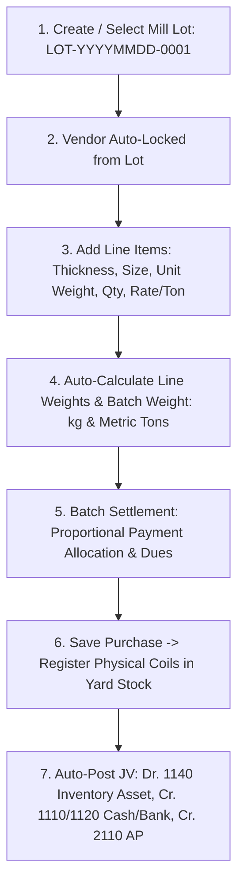
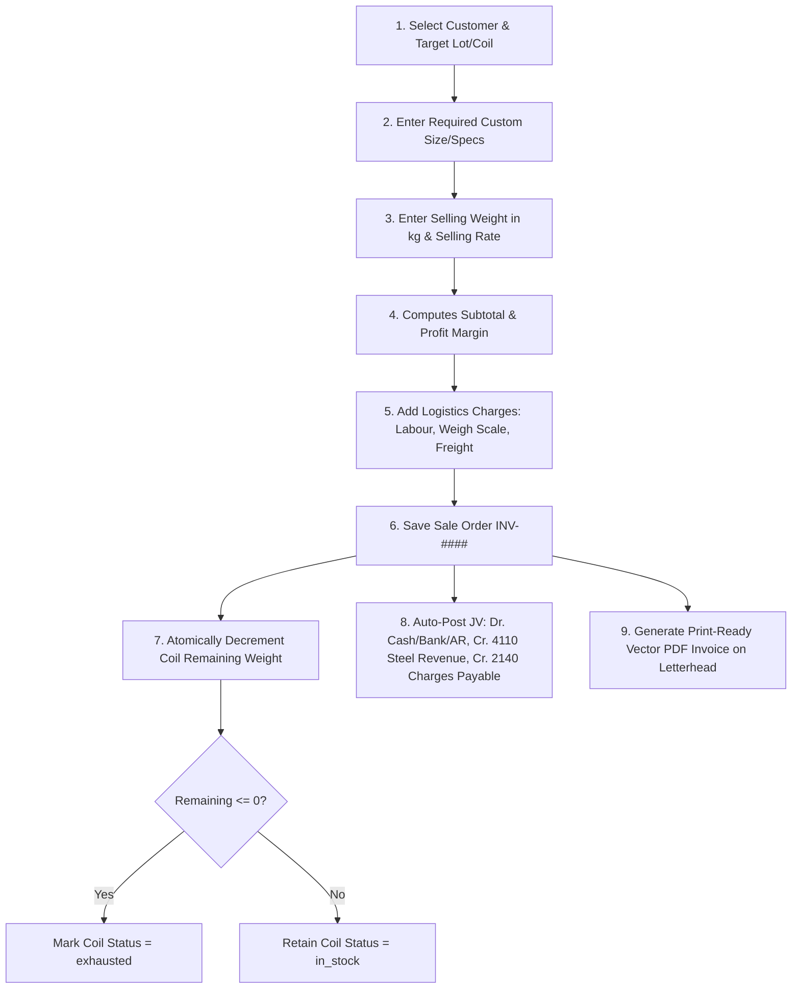
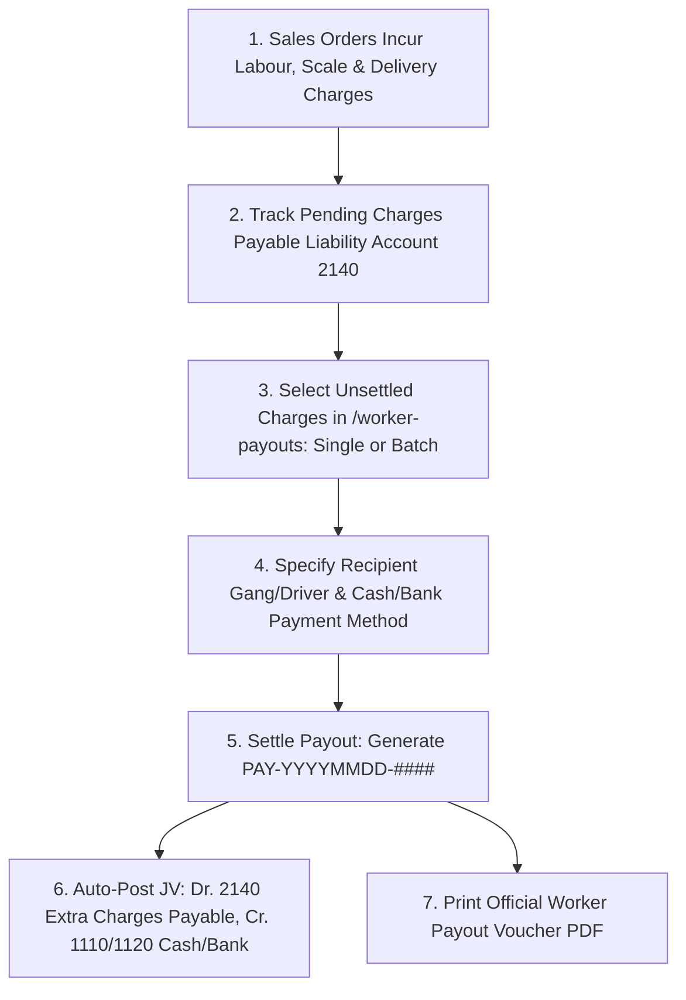
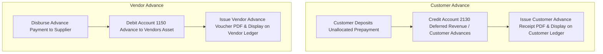

# 🏗️ Steel Inventory (Ship Steel Coils & Plates ERP) — Deep Project Analysis

> **App Name:** Steel Inventory (`steel_inventory`)  
> **Framework:** Laravel 11.57.0  
> **PHP Requirement:** ^8.2 (Running PHP 8.3.28)  
> **Database:** MySQL (`steel_inventory`) / SQLite Compatible  
> **Environment:** Local (Laragon / `127.0.0.1:8000`)  
> **Active Routes:** 250+ Registered Routes  
> **Test Suite:** 75 Automated Feature & Unit Tests (429 Assertions — 100% Passing)  
> **Last Updated:** October 2026  

---

## 1. 🗂️ Project Overview

**Steel Inventory** is an industrial-grade enterprise ERP, double-entry accounting system, and **ship steel coil/plate yard management system** built on **Laravel 11**. Designed specifically for steel manufacturing mills, ship-breaking steel re-rollers, plate stockists, retail outlets, and heavy industrial distribution yards:

- **Ship Steel Coils & Heavy Plates Registry**: Continuous physical stock tracked at the individual piece/coil level (`COIL-YYYYMMDD-####`), recording dimensional specifications (thickness, width, length/size, piece count, intake net weight in kg, remaining weight in kg, rate per ton, and real-time status: `in_stock`, `in_processing`, `exhausted`, `scrapped`).
- **Direct Opening Stock Management**: Dedicated onboarding interface (`/inventory/opening-stock`) allowing yards to register existing coil stock with full dimensional attributes, pricing, and storage location assignments without requiring mill lot purchases.
- **Mill Lot Procurement Management**: Batch procurement linked to Mill/Consignment Lots (`LOT-YYYYMMDD-####`), recording multi-row physical intake with vendor locking, quick AJAX lot registration, row weight calculations (kg and metric tons), proportional batch payment allocation, and automatic yard coil registration.
- **Dedicated Creation & Editing Interfaces**: Full-width dedicated interfaces for Purchase Creation (`/purchase/create`) and Purchase Editing (`/purchase/{id}/edit`) with **Sold Weight Protection Checks** ensuring intake weight cannot be reduced below already sold/dispatched quantities.
- **Commercial Sales & Direct Logistics Billing**: Sales order fulfillment (`INV-####`) with fractional coil weight deduction, custom cutting specifications (`custom_size`), line-item profit tracking against acquisition rates, and **direct delivery charge billing to invoice grand total and payable**.
- **Intuitive Sale Order Editing**: Interactive sale edit screen (`/sales/{id}/edit`) preserving previously entered custom sizes and featuring an inline line-item edit button to load existing items back into the builder card.
- **Automated FIFO Due Settlement & Categorized History**: Intelligent due collection engine (`/due-payments`) automatically settling opening dues and unpaid orders chronologically via FIFO without manual target selection. On customer profiles (`/customers/{id}`), displays a **Categorized (Invoice-Based) Payment Collections & Due Settlements History** with real-time invoice filtering, financial breakdown pills, and expand/collapse accordions.
- **Worker Extra Charges & Payouts Settlement**: Comprehensive disbursement engine (`/worker-payouts`) tracking crane labour gangs, weighbridge operators, and freight haulers. Supports batch and single payouts, cash/bank clearing, automated journal voucher generation, and printable payout vouchers.
- **Customer & Vendor Advances Workflow**: Dedicated prepayments module (`/customer-advances`, `/vendor-advances`) managing unallocated customer deposits (Deferred Revenue / Liability 2130) and upfront vendor disbursements (Asset 1150) with automated receipt/voucher generation, advance refund workflows, and running ledger integration.
- **Dedicated Retail Shop Module**: Side-by-side Point-of-Sale (POS) direct retail sales interface (`/shops/sales/create`), side-by-side shop stock procurement intake (`/shops/purchases/create`), shop return management (`/shops/returns`), shop stock reports (`/shops/stock-report`), and Shop Profile & Settings management (`/shops/settings`).
- **All-in-One Master Transaction & Activity Logs**: Comprehensive consolidated audit trail (`/master-report`) tracking sales, purchases, customer/vendor payments, inventory movements, expenses, and returns with date and module filtering.
- **Product Returns, Restocking & Balance Reconciliation**: Structured return authorization (`returns`, `return_items`) with return condition assessment, automatic physical coil restocking (`remaining_weight` restoration and `in_stock` reactivation), and synchronized refund accounting (invoice due deduction or cash/bank account balance decrements).
- **Full Double-Entry Accounting & Financial Statements**: 5-Class Chart of Accounts (Asset 1000, Liability 2000, Equity 3000, Revenue 4000, Expense 5000), self-balancing journal vouchers (`JV-YYYYMMDD-####`), General Ledger, Trial Balance, Profit & Loss (P&L with real-time accrual calculation), Balance Sheet, Cash Flow Statement, Fiscal Year closing, and Customer/Vendor Party Ledgers.
- **Laptop & High-Density Screen Responsiveness**: Global ergonomic optimization for standard laptops (1200px–1440px / 768px–900px), with compact form controls, height-constrained modals, sticky summary calculators, and an **auto-collapsing 62px mini-sidebar** with hover-to-expand drawer navigation.
- **mPDF Vector Report Standard & Unified PdfService**: High-fidelity vector PDF generation matching the application design system via `App\Services\PdfService` with base64 letterhead watermarks, dark slate header typography, zebra striping, and authorized signature blocks.
- **Role-Based Access Control (RBAC)**: Spatie Permission (`spatie/laravel-permission ^6.4`) with granular permissions across 11 functional modules and two core roles (`Super Admin` and `Employee`).
- **Phase 1–3 Security, Performance & Index Engineering**: Built-in IDOR protection, transactional cleanup routines, SQL aggregation shortcuts, batch account balance calculations, and compound performance indexes across all high-throughput tables.

---

## 2. 🏗️ Architecture & Directory Structure

```
steel_inventory/
├── app/
│   ├── Console/Commands/
│   │   └── InitAccountBalances.php       # Artisan command (accounts:init-balances)
│   ├── Events/
│   │   └── SaleCreatedEvent.php          # Real-time WebSocket event for sales
│   ├── Helpers/
│   │   ├── FormatHelper.php              # Formatting utilities
│   │   ├── LibraryHelper.php             # Library & asset helper routines
│   │   ├── NumberToWords.php             # Number to words converter (for invoices and vouchers)
│   │   └── helpers.php                   # Global accounting helpers (postJournalEntry, getAccountBalance, reverseJournalEntry, getInvoicePadBase64)
│   ├── Http/
│   │   ├── Controllers/                  # 34 Domain controllers
│   │   │   ├── CustomerAdvanceController.php  # Customer prepayments & deposits
│   │   │   ├── VendorAdvanceController.php    # Vendor advance disbursements
│   │   │   ├── WorkerPayoutController.php     # Extra charges & handler settlements
│   │   │   ├── ShopController.php             # Retail POS, intake & shop returns
│   │   │   ├── SalesController.php            # Sales orders & invoices
│   │   │   ├── PurchaseController.php         # Mill procurement & intake
│   │   │   ├── InventoryController.php        # Stock registry & opening stock
│   │   │   ├── LotController.php              # Consignment Mill Lots
│   │   │   ├── PaymentController.php          # Customer/Vendor payment receipts
│   │   │   ├── MasterLogReportController.php  # Consolidated all-in-one logs
│   │   │   ├── FinancialStatementController.php # P&L, Balance Sheet, Cash Flow
│   │   │   ├── ChartOfAccountController.php   # 5-Class accounts tree
│   │   │   ├── JournalEntryController.php     # Double-entry vouchers & CSV/PDF
│   │   │   ├── LedgerController.php           # General Ledger audit statements
│   │   │   ├── TrialBalanceController.php     # Debit/Credit equilibrium checks
│   │   │   ├── FiscalYearController.php       # Accounting period locks
│   │   │   ├── FrontendController.php         # Executive & Employee Dashboards
│   │   │   └── ... (HR, Bank, Warehouse, Company, Security controllers)
│   │   ├── Middleware/                   # Spatie RBAC, auth guards
│   │   └── Requests/                     # Form requests (StoreSaleRequest, StorePurchaseRequest, etc.)
│   ├── Mail/                             # Mailable classes (e.g. CreateSalesMail)
│   ├── Models/                           # 31 Eloquent models (Coil, Purchase, Lot, Sale, WorkerPayout, WorkerPayoutItem, etc.)
│   └── Services/                         # Dedicated business domain services
│       ├── InventoryService.php          # Stock decrement, status updates & weight checks
│       ├── PdfService.php                # Centralized mPDF instance & response factory
│       ├── PurchaseService.php           # Procurement transactions & automated AP vouchers
│       └── SaleService.php               # Sales order processing, stock deductions & AR vouchers
├── database/
│   ├── migrations/                       # 16 Database migrations (Auth, ERP, Accounting, Worker Payouts, Indexes)
│   ├── factories/
│   └── seeders/                          # UserSeeder, PermissionSeeder, ChartOfAccountSeeder, DatabaseSeeder
├── resources/
│   ├── views/
│   │   ├── frontend/                     # ERP views (Blade templates)
│   │   │   ├── layouts/                  # app, head, header, sidebar, right_sidebar
│   │   │   └── pages/                    # 26 module sections (advances, worker_payouts, shops, sales, purchase, etc.)
│   │   ├── pdf/                          # 19 mPDF templates (invoices, ledgers, vouchers, statements)
│   │   │   └── accounts/                 # Voucher, Ledger, Trial Balance, P&L, Balance Sheet
│   │   ├── auth/                         # Authentication views
│   │   └── errors/
│   ├── css/, js/, sass/
├── routes/
│   ├── web.php                           # Main application routes (250+ active routes)
│   ├── api.php                           # API endpoints (Sanctum protected)
│   └── console.php
├── tests/
│   ├── Feature/                          # 12 Feature test suites (Accounting, Security, Advances, Workflows, Indexes)
│   └── Unit/                             # 1 Unit test suite (Customer financial calculations)
├── public/                               # Assets, letterhead pads (assets/invoice/pad.png), uploads
├── config/                               # App, auth, permission, database configurations
└── storage/
```

### Architectural Patterns & Principles
- **MVC Architecture** — Strict separation between Eloquent Models, Blade Views, and Domain Controllers.
- **Service Layer Pattern** — Complex transactional operations encapsulated in `PurchaseService`, `SaleService`, `InventoryService`, and `PdfService` with ACID database safety and automated accounting voucher posting.
- **Weight-Based Inventory Integrity** — Continuous physical stock is maintained in `coils` as decimal weights (kg/tons). Sales transactions decrement remaining weight and update status flags (`in_stock` → `exhausted`) atomically.
- **Side-by-Side Ergonomic Layouts** — Point-of-Sale direct sales and direct stock purchases provide dual-pane workflows (left: items builder; right: sticky live financial calculator).
- **Auto-Collapsing Mini-Sidebar** — Non-intrusive 62px sidebar expands on mouse hover and automatically collapses on mouse leave, dedicating 95%+ screen space to operational tables and data forms.
- **Double-Entry Accounting Engine** — Self-balancing journal voucher posting with debit/credit equilibrium guarantees (`postJournalEntry()`), Storno error reversals (`reverseJournalEntry()`), and strict fiscal period guards.
- **Centralized Vector PDF Engine** — `App\Services\PdfService` standardizes millimeter page margins, base64 letterhead watermarks, dark slate header typography, zebra striping, and authenticated signature blocks.

---

## 3. 🔑 Authentication & Authorization

### Authentication
- Built on `laravel/ui` (Bootstrap 5 authentication scaffolding).
- **Public registration disabled** → `Auth::routes(['register' => false, 'reset' => false, 'verify' => false])`.
- Secondary PIN-based administrative authorization (`/user/pin`).
- `laravel/sanctum` installed for API token authorization.

### Authorization — Spatie Role-Based Access Control (RBAC)
Managed by **Spatie Laravel Permission** (`spatie/laravel-permission ^6.4`):

| Role | Access Scope |
|------|--------------|
| **Super Admin** | Full access to all 12 operational modules: Administration, Sales & Commercial, Customers & Advances, Procurement & Lots, Vendors & Advances, Inventory/Coils & Opening Stock, Retail Shops, Worker Payouts & Extra Charges, Accounts & Finance, HR & Payroll, Company Profile, Reports & Logs |
| **Employee** | Dedicated Employee Dashboard (`/dashboard`) + personal TA/DA self-service portal (`/employee/tada`) with strict IDOR protections |

---

## 4. 📊 Core Modules & Capabilities

### 4.1 🏷️ Steel Procurement & Mill Lot Management
Designed for industrial steel procurement where goods are sourced in mill batches (Consignment Lots) with dimensional specifications:

| Model | Table | Key Fields & Capabilities |
|-------|-------|--------------------------|
| `Lot` | `lots` | `lot_number` (`LOT-YYYYMMDD-0001`), `vendor_id`, `lot_date`, `status` (`active`/`closed`), `total_quantity` (weight sum), `total_amount`, `notes`, `created_by` |
| `Purchase` | `purchases` | `lot_id`, `vendor_id`, `warehouse_id`, `thickness`, `size`, `size_type`, `unit_weight`, `total_weight`, `quantity`, `unit_price`, `sub_price`, `total_price`, `payment`, `due`, `payment_method`, `bank_detail_id`, `transport_payer`, `delivery_charge`, `labour_cost`, `weight_scale_cost`, `other_charges`, `charges_payout_status` |

#### Key Steel Procurement Features:
- **Dedicated Purchase Order Creation (`/purchase/create`)**:
  - Full-width line item table supporting dynamic multi-row creation.
  - **Lot-Vendor Coupling**: Selecting a Lot auto-populates and locks the Vendor.
  - **Embedded Quick Add Lot**: Modal on create purchase page for instant AJAX Lot registration without losing form state.
  - **Batch & Row Weight Engine**: Calculates line item weight (`quantity * unit_weight`) and batch totals in Kilograms (kg) and Metric Tons.
  - **Proportional Payment Allocation**: Distributes batch payments across line items and calculates exact item dues.
  - **Automated Coil Registration**: Automatically inserts a matching physical coil record into `coils` for immediate yard stock tracking.
  - **Auto-Posting Journal Voucher**: Intakes inventory (Dr. 1140 Inventory Asset) against Cash/Bank disbursements (Cr. 1110/1120) and Accounts Payable (Cr. 2110).
- **Dedicated Purchase Order Editing (`/purchase/{id}/edit`)**:
  - Edit physical specifications, quantities, weights, and pricing.
  - **Sold Weight Protection Check**: Detects if any portion of the linked coil has already been sold and prevents lowering intake weight below the sold quantity.
  - Synchronizes linked `coils` record and recalculates affected Lot totals.
- **Vendor Due Payments (`/vendor-due-payments`)**: Filterable overview of outstanding vendor balances with batch settlement and instant mPDF statement export (`/vendor-due-payments/pdf`).

---

### 4.2 ⚙️ Ship Steel Coils, Heavy Plates & Opening Stock Registry
The single source of truth for physical inventory in the yard:

| Model | Table | Key Fields & Capabilities |
|-------|-------|--------------------------|
| `Coil` | `coils` | `coil_number` (`COIL-YYYYMMDD-0001`), `purchase_id`, `lot_id`, `vendor_id`, `warehouse_id`, `thickness`, `width`, `length`, `piece_count`, `gross_weight`, `tare_weight`, `net_weight`, `remaining_weight`, `rate_per_ton`, `total_price`, `status` (`in_stock`, `in_processing`, `exhausted`, `scrapped`) |
| `Warehouse` | `warehouses` | Storage yards, retail shops (`type: shop`, `type: warehouse`), and warehouse capacity tracking |

#### Key Coil & Opening Stock Features:
- **Sequential Coil Tagging**: Unique auto-generated coil identifiers (`COIL-YYYYMMDD-####`).
- **Direct Opening Stock Management (`/inventory/opening-stock`)**:
  - Onboard pre-existing yard coils and plates directly into physical stock without requiring mill lot purchases.
  - Full CRUD support: Create, edit, update, and delete opening stock records with inventory valuation and weight tracking.
- **Computed Attributes**:
  - `remaining_coils`: Converts remaining weight into remaining physical pieces.
  - `remaining_percentage`: Real-time percentage of remaining weight relative to intake net weight.
  - `unit_weight`: Weight per piece/plate.
- **Stock Overview & PDF Export**: Filterable by Lot, Vendor, Warehouse Yard, and Status, with instant mPDF stock inventory report generation (`/inventory/pdf`).

---

### 4.3 💰 Sales, Commercial Logistics & Extra Charges
| Model | Table | Key Fields & Capabilities |
|-------|-------|--------------------------|
| `Sale` | `sales` | `order_no` (`INV-####`), `order_date`, `customer_id`, `subtotal`, `discount`, `vat`, `tax`, `total`, `payble`, `advanced_payment`, `due_payment`, `payment_method`, `bank_detail_id`, `delivery_status`, `transport_payer`, `delivery_charge`, `labour_cost`, `weight_scale_cost`, `other_charges`, `charges_payout_status`, `status` |
| `SalesItem` | `sales_items` | `order_id`, `coil_id`, `lot_id`, `thickness`, `size`, `size_type`, `custom_size` (required custom specs), `qty` (weight), `unit_price`, `total_price`, `purchase_price`, `profit`, `returned_qty` |
| `Customer` | `customers` | Client records with opening balances, effective net due, and ledger history |
| `Payment` | `payments` | Customer receipts, vendor disbursements, advance deposits, and settlement records |

#### Key Sales & Customer Settlement Features:
- **Direct Delivery Charge Billing**: Transport freight (`delivery_charge`) is directly linked and billed to invoice grand total, payable, and due payments across all commercial sales, shop POS sales, and edit workflows. Obsolete `transport_payer` toggles have been removed for streamlined operational billing.
- **Mandatory Custom Sizing & Edit Persistence**: Requires custom slitting/cutting dimensions (`custom_size`) for each item. The sale editing interface (`/sales/{id}/edit`) preserves existing custom sizes without validation errors, and features an inline line-item **Edit** button that loads the item's Lot, Custom Size, Rate, and Quantity back into the builder card for instant adjustments.
- **Automated FIFO Due Settlement**: The direct due collection modal on `/due-payments` automatically applies collections via chronological **FIFO** (`auto_due_settlement`): clears opening dues first, then oldest unpaid invoices, and stores surplus as customer advance credit.
- **Categorized (Invoice-Based) Payment Collections History**: On the customer profile (`/customers/{id}`), payment collections are cleanly organized into **Invoice Category Cards** displaying:
  - Original invoice total, total receipts collected, and remaining due.
  - Sub-tables with payment dates, channels, transaction refs, remarks, refund badges, and 3-dot action dropdowns (Edit Payment, Receipt PDF, Delete/Revert).
  - Client-side category filter pills for instant invoice-by-invoice filtering.
  - "Expand All" / "Collapse All" panel toggles and a tab switcher to view the flat chronological ledger.
- **Fractional Weight Deductions**: Selling deducts sold weight from `coils.remaining_weight`. When remaining weight reaches 0, status transitions to `exhausted`.
- **Pass-Through Extra Charges**: Captures crane/labour fees (`labour_cost`), certified bridge scale fees (`weight_scale_cost`), and transport freight (`delivery_charge`).
- **Customer Party Ledger (`/customers/{id}/ledger`)**: Running balance statement showing prior balance, invoices, payments, and balance carried forward, exportable via mPDF (`/customers/{id}/ledger/pdf`).
- **Customer Due Payments (`/due-payments`)**: Filterable receivable tracking with live invoice balance lookups and vector PDF export (`/due-payments/pdf`).
- **High-Precision Invoice Generation (`/sales/invoice/{id}/pdf`)**: Print-ready sales invoices on official letterhead with complete specification breakdowns.

---

### 4.4 👷 Worker Extra Charges & Payouts Settlement
A dedicated sub-system managing disbursements to third-party labourers, crane operators, certified weigh scales, and freight drivers:

| Model | Table | Purpose |
|-------|-------|---------|
| `WorkerPayout` | `worker_payouts` | Payout headers (`PAY-YYYYMMDD-####`), payout date, recipient name/phone, total amount, payment method (Cash, Bank, Mobile Banking), and linked GL clearing account |
| `WorkerPayoutItem` | `worker_payout_items` | Line-item allocations linking each payout slice back to the original `sale_id` and `charge_type` (`labour`, `delivery`, `weight_scale`, `other`) |

#### Key Worker Payout Features:
- **Direct SQL KPI Aggregation**: Dashboard and index metrics calculate Total Collected Charges vs. Total Disbursed vs. Net Pending Liability directly in SQL without N+1 overhead.
- **Batch & Single Settlement Modes**:
  - Batch Settlement (`/worker-payouts/batch-settle`): Settle multiple sales charges simultaneously for a single labour gang or transport vendor.
  - Single Settlement (`/worker-payouts/single-settle/{id}`): Quickly disburse individual sale extra charges.
- **Accounting Integration**: Automatically credits Cash/Bank (1110/1120) and debits Extra Charges Payable (2140).
- **Voiding & Reversal (`/worker-payouts/{id}/void`)**: Safely voids payouts with automatic Storno reversal vouchers and resets sales charges payout status.
- **Voucher & Report Generation**: Printable mPDF Worker Payout Voucher (`/worker-payouts/{id}/voucher-pdf`) and Extra Charges Master Report (`/charges-report`, `/charges-report/pdf`).

---

### 4.5 💳 Customer Advances & Vendor Advances Workflow
Specialized financial sub-system managing pre-billing deposits and pre-procurement advances:

| Feature | Routes | Accounting & Operational Logic |
|---------|--------|--------------------------------|
| **Customer Advances** | `/customer-advances`, `/customer-advances/create`, `/customer-advances/pdf`, `/customer-advances/{id}/receipt-pdf` | Records unallocated customer deposits, credited to **Deferred Revenue / Customer Advances (Liability 2130)**. Displays live customer advance credit balances, creates formal payment records (`payment_for = 2`), and prints Money Receipts. |
| **Vendor Advances** | `/vendor-advances`, `/vendor-advances/create`, `/vendor-advances/pdf`, `/vendor-advances/{id}/voucher-pdf` | Records upfront supplier prepayments before mill consignment delivery, debited to **Advance to Vendors (Asset 1150)**. Displays active vendor prepayments, creates disbursement records (`payment_for = 3`), and prints Payment Vouchers. |

---

### 4.6 🏪 Retail Shop Module (Side-by-Side POS, Intake & Returns)
A specialized module built for retail outlet operations distinct from the main yard:

| Section | Route | Layout & Capabilities |
|---------|-------|------------------------|
| **Shop POS Direct Sale** | `/shops/sales/create` | Side-by-side layout: Left side coil picker & product builder; Right side sticky live calculator for Subtotal, Discount, Delivery, Labour, Advance payment, and Due. |
| **Shop Direct Purchase** | `/shops/purchases/create` | Side-by-side layout: Left side Lot & intake item builder; Right side sticky Landed Cost, Advance payment, and Net Due calculator. |
| **Shop Returns Management** | `/shops/returns`, `/shops/returns/create` | Complete retail return workflow: Select shop sale, inspect returned pieces, adjust customer balance, restock shop coils, and view return details. |
| **Shop Stock Report** | `/shops/stock-report`, `/shops/stock-report/pdf` | Filterable stock overview isolated to retail shop locations with dedicated vector mPDF export. |
| **Shop Settings & Profile** | `/shops/settings` | Profile management to update shop name, contact phone, email, and outlet address. |
| **Shop Sales & Purchases Lists** | `/shops/sales`, `/shops/purchases` | Dedicated filtered listings of retail outlet transactions. |

---

### 4.7 📑 All-in-One Master Activity & Transaction Logs Report
A central consolidation report located at `/master-report` (`reports.master`):
- **Unified Event Ledger**: Merges and chronologically sequences 6 core business flows:
  1. Sales Orders (`Sale`)
  2. Purchase Inwards (`Purchase`)
  3. Customer & Vendor Payments (`Payment`)
  4. Coil Stock Inward Movements (`Coil`)
  5. Daily Operating Expenses (`DailyExpense`)
  6. Product Restocking & Returns (`ProductReturn`)
- **Filterable & Auditable**: Filter by Date Range, Module Type, and Search query, displaying clean transaction dates, reference IDs, and financial/weight summaries with instant vector PDF export (`/master-report/pdf`).

---

### 4.8 📒 Double-Entry Accounting & Financial Statements
A complete GAAP/IFRS-compliant double-entry accounting engine fully integrated with operational transactions:

| Model | Table | Purpose |
|-------|-------|---------|
| `ChartOfAccount` | `chart_of_accounts` | 5-Class tree: Asset (1000), Liability (2000), Equity (3000), Revenue (4000), Expense (5000). Linked to `bank_details`. |
| `FiscalYear` | `fiscal_years` | Accounting periods with start/end dates, active status flag, and year-end closing locks. |
| `JournalEntry` | `journal_entries` | Immutable voucher headers with auto-sequencing `JV-YYYYMMDD-0001`, audit metadata, and Storno reversal keys. |
| `JournalEntryItem` | `journal_entry_items` | Split debit and credit transaction lines with individual account allocations. |

#### Core Accounting Engine:
- **Master Chart of Accounts**: Pre-seeded standard accounts with normal balance rules (`isDebitNormal()`) and high-performance batch balance calculations (`ChartOfAccount::batchCalculateBalances()`).
- **Journal Vouchers (JV)**: Multi-row split debit/credit creator with real-time balance validation.
- **General Ledger**: Chronological transaction audit trail with running balances, opening balance brought forward, date filters, and PDF/CSV export.
- **Trial Balance**: Instant debit vs. credit balance validation verifying equation equilibrium across all active accounts.
- **Financial Statements**:
  - Profit & Loss (P&L) with Gross Margin and Net Operating Income.
  - Balance Sheet with Asset, Liability, and Equity balancing.
  - Cash Flow Statement categorized by Operating, Investing, and Financing activities.
- **Auto-Posting Triggers**: Operational hooks in `SaleService`, `PurchaseService`, `WorkerPayoutController`, `ExpenseController`, and `SalaryController` automatically generate balanced vouchers.

---

### 4.9 🔄 Product Returns, Restocking & Personnel
- **Product Returns (`returns`, `return_items`)**: Structured return workflow with condition recording, inventory restocking, refund tracking, and status transitions (`pending` → `approved` → `completed` / `rejected`):
  - **Physical Stock Restoration**: Approving a return immediately adds returned weight back to the physical Coil (`remaining_weight += quantity`). If the coil was marked `exhausted`, its status is automatically switched back to `in_stock`. Synchronizes legacy `inventories` and tracks `sales_items.returned_qty`.
  - **Synchronized Refund & Balance Reconciliation**:
    - *Unpaid Invoice Dues*: If the customer still owes money on the order, the return amount reduces the invoice due and credits Accounts Receivable (`1130`) without disbursing liquid funds.
    - *Paid Invoices*: If already paid, the refund is disbursed via Cash or Bank/MFS. Automatically reduces `bank_details.current_balance`, logs a negative refund payment, and posts a balanced journal entry (Debit 5120 Sales Returns & Allowances, Credit 1110/1120 Cash/Bank).
- **HR & Payroll (`employees`, `salaries`, `ta_das`)**: Monthly salary generation, advance salary deductions, and employee self-service TA/DA request portal with strict user ID ownership verification.
- **Operational Expense Tracking (`daily_expenses`, `expense_categories`)**: Categorized petty cash and yard expense tracking with unified Cash/Bank selection and transactional journal cleanup.

---

## 5. 🗄️ Database Schema & Migrations

> **Total Migrations:** 16 Database Migrations  
> **Database Engine:** MySQL (`steel_inventory`) / SQLite Compatible  

```
database/migrations/
├── 2024_01_01_000001_create_users_and_auth_tables.php
│   └── users, password_resets, failed_jobs, personal_access_tokens
├── 2024_01_01_000002_create_permission_tables.php
│   └── roles, permissions, model_has_roles, model_has_permissions, role_has_permissions
├── 2024_01_01_000003_create_activity_logs_and_extras_tables.php
│   └── activity_logs, extras
├── 2024_01_01_000004_create_master_entities_tables.php
│   └── company_details, bank_details, warehouses, vendors, customers, lots
├── 2024_01_01_000005_create_hr_and_expenses_tables.php
│   └── employees, salaries, expense_categories, daily_expenses, ta_das
├── 2024_01_01_000006_create_procurement_and_coils_tables.php
│   └── purchases, coils, inventories
├── 2024_01_01_000007_create_sales_and_returns_tables.php
│   └── sales, sales_items, payments, returns, return_items
├── 2024_01_01_000008_create_accounting_system_tables.php
│   └── fiscal_years, chart_of_accounts, journal_entries, journal_entry_items
├── 2024_01_01_000009_add_charges_to_purchases_table.php
│   └── adds delivery_charge, labour_cost, weight_scale_cost, other_charges, charges_payout_status to purchases
├── 2024_01_01_000010_create_worker_payouts_tables.php
│   └── worker_payouts, worker_payout_items
├── 2024_01_01_000011_add_bank_detail_id_to_daily_expenses_table.php
│   └── adds bank_detail_id to daily_expenses
├── 2026_09_21_115200_add_custom_size_to_sales_items_table.php
│   └── adds custom_size to sales_items
├── 2026_09_27_140000_add_transport_payer_to_purchases_and_sales.php
│   └── adds transport_payer ('me'/'vendor') to purchases and sales
├── 2026_10_03_145000_add_type_to_warehouses_table.php
│   └── adds type ('warehouse'/'shop') to warehouses
├── 2026_10_06_160000_add_performance_indexes_to_core_tables.php
│   └── adds high-throughput indexes on coils, sales, purchases, payments, journal_entries
└── 2026_10_13_180000_add_missing_performance_indexes.php
    └── adds compound indexes on returns, bank_details, lots, salaries, employees, inventories
```

---

## 6. 📦 Key Dependencies & Technology Stack

### Backend
| Package | Version | Purpose |
|---------|---------|---------|
| `laravel/framework` | ^11.57.0 | Core web framework |
| `php` | ^8.2 (Running 8.3.28) | Language requirement |
| `laravel/ui` | ^4.5 | Bootstrap auth scaffolding |
| `laravel/sanctum` | ^4.0 | API token authentication |
| `spatie/laravel-permission` | ^6.4 | Granular Role-Based Access Control |
| `spatie/laravel-activitylog` | ^4.12 | Transaction and user audit logging |
| `spatie/laravel-backup` | ^9.3 | Database and file backups |
| `mpdf/mpdf` | ^8.3 | High-precision vector PDF generation with custom letterhead pads |
| `maatwebsite/excel` | ^3.1 | CSV and spreadsheet exports |
| `pusher/pusher-php-server` | ^7.2 | Real-time WebSocket notifications |
| `twilio/sdk` | ^8.3 | SMS notifications |

### Frontend & UI Guidelines
- **Blade Templating Engine** with Bootstrap 5 layout components.
- **Laptop & Responsive Density Engine**: Media queries for 1200px–1440px widths and 768px–850px heights.
- **Hover-to-Expand Mini-Sidebar**: 62px default mini-sidebar with 0.92rem crisp icons; expands to 248px on hover and auto-collapses on mouse leave.
- **Select2 & Unified Selectors**: Standardized compact 37px input heights with unified Cash/Bank account pickers.
- **No Breadcrumbs Policy**: Strict project guideline (`.agents/AGENTS.md`) eliminating `<ul class="breadcrumb">` navigation tags for modern, clean headers.
- **3-Dot Table Action Dropdowns**: Configured with `data-bs-popper-config='{"strategy":"fixed"}'` to ensure dropdown menus float freely above table containers without viewport clipping.

---

## 7. 🛣️ Route Structure & Navigation

The application registers **250+ active routes** organized into 10 main workflow sections:

| Section | Key Routes | Primary Controller | Functionality |
|---------|------------|--------------------|---------------|
| **Dashboard** | `/dashboard` | `FrontendController` | Executive metrics, financial KPI cards, stock summary, recent activities, employee portal |
| **Retail Shop** | `/shops/sales/create`, `/shops/purchases/create`, `/shops/returns/*`, `/shops/stock-report/*`, `/shops/settings` | `ShopController` | Side-by-side POS sales, direct shop intake, shop returns, stock reports, outlet profile |
| **Procurement** | `/purchase`, `/purchase/create`, `/purchase/{id}/edit`, `/lots`, `/vendors`, `/vendor-due-payments` | `PurchaseController`, `LotController`, `VendorController` | Batch purchase orders, lot consignment tracking, vendor profiles, vendor dues & party ledgers |
| **Inventory & Yard** | `/inventory`, `/inventory/opening-stock/*`, `/coils`, `/warehouses` | `InventoryController`, `WarehouseController` | Stock overview, opening stock registry, ship steel coils & plates registry, warehouse/yard management |
| **Sales & Commercial** | `/sales`, `/sales/create`, `/sales/invoice/{id}/pdf`, `/due-payments`, `/product-returns/*` | `SalesController`, `PaymentController`, `ReturnController` | Sales orders, mandatory custom sizing specs, vector PDF invoices, customer receivables, sales returns |
| **Worker Payouts** | `/worker-payouts`, `/worker-payouts/batch-settle`, `/worker-payouts/single-settle/{id}`, `/charges-report` | `WorkerPayoutController` | Handler extra charges settlement, batch disbursements, voiding/reversals, payout vouchers |
| **Advances** | `/customer-advances/*`, `/vendor-advances/*` | `CustomerAdvanceController`, `VendorAdvanceController` | Prepayments management, customer deposit receipts, vendor disbursement vouchers, advance ledgers |
| **Accounts & Finance** | `/accounts/chart-of-accounts`, `/accounts/journal-entries`, `/accounts/ledger`, `/accounts/trial-balance`, `/accounts/reports/*` | `ChartOfAccountController`, `JournalEntryController`, `LedgerController`, `TrialBalanceController`, `FinancialStatementController` | Double-entry bookkeeping, general ledger, trial balance, P&L, balance sheet, cash flow |
| **HR & Payroll** | `/employees`, `/salary`, `/daily-expenses`, `/employee/tada` | `EmployeeController`, `SalaryController`, `ExpenseController`, `EmployeeTaDaController` | Staff records, monthly payroll, petty cash expenses, employee self-service TA/DA |
| **Administration** | `/users`, `/role`, `/permission`, `/company-details`, `/bank-details` | `UserController`, `RoleController`, `PermissionController`, `CompanyDetailController`, `BankDetailController` | User access, RBAC security, corporate profile, bank accounts |

---

## 8. 🔄 Core Steel Business Workflows

### Steel Lot Procurement & Yard Intake Flow


### Steel Sales & Custom Sizing Flow


### Worker Extra Charges Payout Flow


### Customer & Vendor Advances Flow


---

## 9. 🧪 Testing & Quality Assurance

The codebase includes an enterprise-grade automated test suite ensuring high reliability across security, accounting, workflows, and database performance:

| Test Suite | File | Tests | Assertions | Core Validations |
|------------|------|-------|------------|------------------|
| **Accounting Integrity** | `AccountingDoubleEntryTest.php` | 1 | 4 | Verifies strict double-entry balance equilibrium on journal vouchers. |
| **Advances Workflow** | `AdvancePaymentsWorkflowTest.php` | 8 | 24 | Tests Customer & Vendor advances index, creation, receipt/voucher PDFs, and ledger impacts. |
| **Advance Refunds Workflow** | `AdvanceRefundWorkflowTest.php` | 7 | 22 | Tests customer advance refunds, vendor advance returns, validation limits, and ledger sync. |
| **Authentication & Access** | `AuthAndAccessTest.php` | 4 | 10 | Validates login guards, role-based redirection, dashboard authorization, and safe logout. |
| **Balance Transfers** | `BalanceTransferWorkflowTest.php` | 6 | 22 | Inter-account transfers (Cash to Bank, Bank to Cash), validation guards, and Storno reversal. |
| **Customer Due Collections** | `CustomerDueCollectionWorkflowTest.php` | 8 | 42 | FIFO auto due settlements, unallocated reconciliations, payment edits/deletions, and bank sync. |
| **End-to-End Business Flow** | `EndToEndBusinessFlowDashboardTest.php` | 1 | 18 | Full end-to-end simulation (Purchase → Sale → Payout → Settlement) matching dashboard KPI cards. |
| **Inventory Stock Reports & PDF** | `InventoryStockPdfTest.php` | 3 | 10 | Validates inventory report vector mPDF generation and segregation of main yard vs retail shop stock. |
| **Phase 1 Security & Integrity** | `Phase1SecurityAndIntegrityTest.php` | 6 | 28 | IDOR protection on TA/DA claims, negative claim rejection, transactional payment and expense deletions. |
| **Phase 2 Performance & Aggregation** | `Phase2PerformanceAndAggregationTest.php` | 4 | 20 | Batch account balance calculations vs. single-query baseline, grouped dashboard queries, SQL KPI aggregations. |
| **Phase 3 Database Indexes** | `Phase3DatabaseIndexesTest.php` | 1 | 35 | Validates presence of performance compound indexes across all high-throughput tables. |
| **Product Returns & Refunds** | `ProductReturnWorkflowTest.php` | 2 | 8 | Product return status helpers, condition evaluation, and bank refund settlement. |
| **Purchase Lifecycle** | `PurchaseWorkflowTest.php` | 3 | 28 | Multi-row batch purchase creation, vendor locking, coil inventory intake, and cash/bank journal posting. |
| **Sales Lifecycle & Returns** | `SaleWorkflowTest.php` | 5 | 23 | Sale creation with direct delivery billing, shop sales exclusion, custom size persistence across edits, and coil return restocking with bank refund. |
| **Shop Purchase Separation** | `ShopPurchaseSeparationTest.php` | 2 | 8 | Verifies isolation of retail shop purchases and lots from industrial yard purchases. |
| **Shop Returns** | `ShopReturnWorkflowTest.php` | 3 | 9 | Retail shop return creation, AJAX line items loader, and shop stock restoration. |
| **Unified Payment Options** | `UnifiedPaymentOptionsWorkflowTest.php` | 4 | 12 | Tests unified Cash/Bank selector across expenses, bill payments, and advances. |
| **Vendor Operations & Dues** | `VendorWorkflowTest.php` | 5 | 22 | Consolidated vendor due payments page, vector mPDF export, batch settlement, and soft-delete safeguards. |
| **Customer Financial Calculations** | `CustomerFinancialTest.php` | 4 | 8 | Opening balance, effective due calculation, and advance credit logic. |
| **Total Automated Coverage** | **19 Test Files** | **75** | **429** | **100% Passing** |

---

## 10. 📋 Setup & Deployment Guide

```bash
# 1. Clone repository and install dependencies
composer install
npm install

# 2. Configure environment file
cp .env.example .env
php artisan key:generate

# 3. Configure Database (.env)
DB_CONNECTION=mysql
DB_HOST=127.0.0.1
DB_PORT=3306
DB_DATABASE=steel_inventory
DB_USERNAME=root
DB_PASSWORD=

# 4. Database Migrations Note:
# CRITICAL: In accordance with project rules, NEVER run migrate:fresh, migrate:rollback,
# or seed commands without explicit user permission.
php artisan migrate

# 5. Seed initial data (Users, Roles, Permissions, Master Chart of Accounts)
php artisan db:seed

# 6. Run test suite to verify system health
php artisan test

# 7. Build frontend assets
npm run build

# 8. Start local development server (or access via Laragon)
php artisan serve
```

> **Default Local Server:** `http://127.0.0.1:8000`

---

*Document updated: October 2026*  
*Maintained by: Antigravity AI Engineering Assistant*
